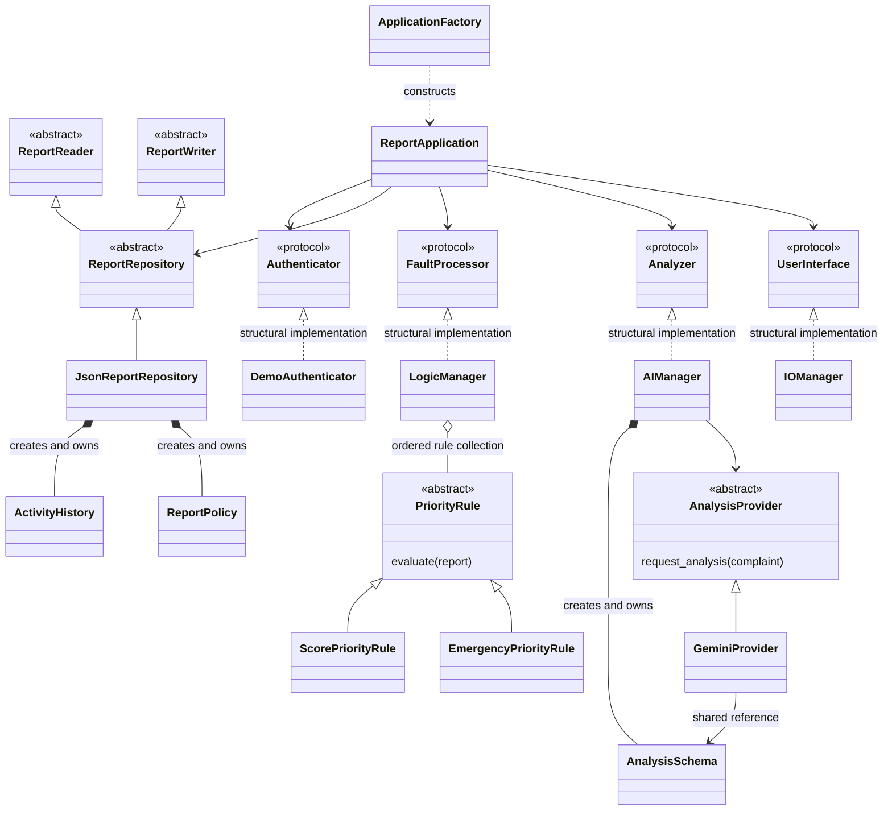
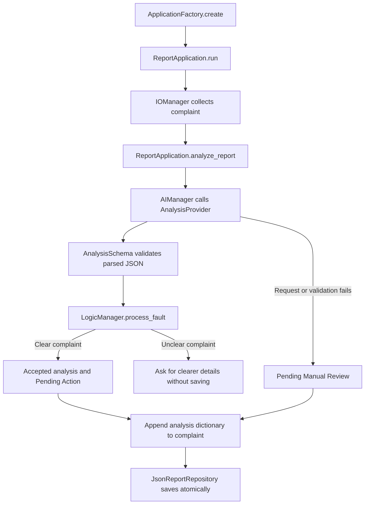

# OOP refactor on appNEW

This branch refactors the application and adds admin pending-review notifications,
complaint activity history, and report search/filtering. The original complaint
fields, Gemini request, business rules, CRUD operations and manual review remain.
Docker changes and CI setup are outside the current scope.

## Migration from Part 1

| Previous functions | New owner |
| --- | --- |
| `main.main()` | `ReportApplication.run()` |
| Other workflows in `main.py`, including `analyze_report()` and `process_new_report()` | Instance methods of `ReportApplication` in `application.py` |
| Input and display functions | `IOManager` |
| `analyze_complaint()` | `AIManager` |
| Gemini SDK request | `GeminiProvider.request_analysis()` |
| `validate_response()` | `AnalysisSchema.validate_response()`, exposed through `AIManager` |
| Severity, routing and alert functions | `LogicManager` |
| Priority selection | Ordered `PriorityRule` objects used by `LogicManager` |
| `authenticate_admin()` | `DemoAuthenticator` |
| JSON storage and ID functions | `JsonReportRepository` |
| Accepted/pending record checks | `ReportPolicy` |
| New activity-event construction | `ActivityHistory`, owned by `JsonReportRepository` |

`main.py` is the composition root: `ApplicationFactory.create()` constructs
the concrete objects, supplies them to the controller, and returns an app.
The controller receives interfaces through its constructor. There are no
module-level workflow functions or shared production manager instances.

The existing six-item input list and seven-item saved record structure remain.
New activity entries are stored in `history` inside the seventh item's dictionary.
Lists and dictionaries are data exchanged by objects; using OOP does not
require changing every data container into a class or migrating saved JSON.

## Class relationships

Protocols describe the operations an object must provide without requiring
explicit inheritance. Abstract base classes require their abstract methods
to be implemented before a subclass can be instantiated. Type annotations
document the dependencies; Python does not automatically validate protocol
conformance at runtime.

## OOP concepts in this application

- **Encapsulation:** each repository has its own `_reports_file`, exposed
  through a read-only property. `AnalysisSchema` exposes immutable category
  and risk tuples and returns a copy of its JSON schema. Underscores indicate
  internal state by Python convention; they are not a security boundary.
- **Abstraction and inheritance:** the provider, priority and repository
  abstract classes define contracts. Concrete classes implement them.
- **Association:** `ReportApplication` references injected collaborators;
  `GeminiProvider` shares the schema owned by its `AIManager`.
- **Aggregation:** `LogicManager` accepts independent priority-rule objects.
  It stores them in a tuple, but a caller can retain and share the same rule
  objects. Their existence does not depend on the manager.
- **Composition:** each `AIManager` creates and owns its `AnalysisSchema`;
  each repository creates and owns its `ReportPolicy` and `ActivityHistory`. These internal parts
  are created for their owner's use rather than injected as independent objects.
- **Polymorphism:** production priority selection invokes `evaluate()` on
  both `EmergencyPriorityRule` and `ScorePriorityRule`. The former tests the
  existing emergency conditions; the latter tests a severity threshold.
  Tests also substitute analysis providers through the same provider contract.

## SOLID mapping

| Principle | Concrete application |
| --- | --- |
| Single responsibility | Terminal interaction, orchestration, API transport, schema validation, fault rules, persistence and authentication have separate owners. |
| Open/closed | Supply another `PriorityRule` or `AnalysisProvider` implementation without editing the controller or the rule-selection loop. Existing category/scoring policy still lives in `LogicManager`. |
| Liskov substitution | Priority implementations accept the same validated report, do not mutate it, and return a priority or `None`. Providers return parsed dictionaries or raise, as their contract permits. The AI manager validates every provider's output. |
| Interface segregation | Read and write repository contracts are separate; the app uses their combined interface because its workflows need both. Authentication and fault processing have narrow contracts, and the UI protocol omits internal input helpers. |
| Dependency inversion | `ReportApplication` depends on contracts, with implementations supplied through its constructor. `main.py` is the place that selects concrete production classes. |

These boundaries support extensions without claiming that every possible
future change can be made without modifying existing code.

**Evidence in the tests, and where the design stops short**

- Single responsibility: `LogicManager` never prints, reads files or calls the
  API, and `AIManager` makes no domain decisions (the prompt forbids scoring,
  priority and contractor choices). `IOManager` is the largest class because
  the project rule keeps every prompt and table in one place.
- Open/closed: `test_oop.py` runs the unchanged controller with `SampleProvider`
  and `UnavailableProvider`, and builds `LogicManager` from supplied rule
  objects. The risk-score table, contractor table and SLA mapping are still
  fixed inside `LogicManager`, so a new category or SLA needs a code edit.
- Liskov substitution: `test_priority_rules_share_one_non_mutating_contract`
  checks both rules against one input without mutating it, and
  `test_schema_validation_cannot_be_bypassed_by_provider` checks that a
  misbehaving provider is still validated.
- Interface segregation: reading and writing are separate contracts, but the
  controller needs both, so it depends on the combined `ReportRepository`.
- Dependency inversion: `test_oop.py` and `test_admin_features.py` build
  `ReportApplication` with injected objects and a replaceable `IOManager`
  reader and writer. `AIManager` still creates a `GeminiProvider` when no
  provider is supplied, and `main.py` remains the only place that chooses
  concrete production classes.

## Existing submission flow

The default provider remains Gemini. No offline fake is selected by the
production factory. Failed AI requests still use the existing manual-review
path. Admin approval still applies the same validation and fault rules.
Because this inherited route permits approval without a successful AI call,
the lecturer should confirm its treatment under the Part 2 AI requirement.
It has not been silently removed or presented as a new feature.

## Regression coverage

The refactor moved behaviour between objects without changing what the
application does. This table records which test protects each behaviour.
`test_pipeline.py` runs with `python test_pipeline.py`; the other files run with
`python -m unittest -v <module>`. All use simulated API responses and temporary
JSON files, so they run offline.

| Behaviour that must not change | Protected by |
| --- | --- |
| Contractor routing for all four categories; severity, priority and SLA for no hazard, leak, wiring, fire and smoke in a common area | `test_pipeline.test_rules` |
| Fire inside a private apartment is EMERGENCY with the SCDF 995 alert and a follow-up-only contractor; a denied "fire" in the text is not escalated | `test_pipeline.test_rules` |
| Manual classification uses the same emergency rules as AI output; the fire alert is still shown if the save then fails | `test_pipeline.test_rules` |
| Schema accepts valid output and rejects missing fields, wrong types and unsupported values | `test_pipeline.test_schema` |
| A provider cannot bypass validation | `test_oop.test_schema_validation_cannot_be_bypassed_by_provider` |
| Only the description, not contact details, is sent to the AI; an optional image is read and closed | `test_pipeline.test_pipeline` |
| Unclear complaints are never saved; unconfirmed records are rejected even by a direct `save_report` call | `test_pipeline.test_pipeline`, `test_pipeline.test_complaint_ids`, `test_oop.test_unclear_provider_output_is_not_saved` |
| AI failure or invalid output saves Pending Manual Review, stores no private error text and skips scoring | `test_pipeline.test_pipeline`, `test_pipeline.test_manual_review`, `test_oop.test_provider_timeout_preserves_manual_review` |
| Admin approval makes no API call, replaces only the selected record, keeps its ID and time, and survives a failed write | `test_pipeline.test_manual_review` |
| Readable IDs continue across restarts (separate process), handle older ID formats and are reused after the highest is deleted | `test_pipeline.test_complaint_ids`, `test_pipeline.test_crud` |
| A failed replace leaves the file byte-for-byte unchanged and leaves no temporary files | `test_pipeline.test_pipeline`, `test_status_updates`, `test_crud`, `test_manual_review` |
| A corrupt file is never overwritten or reset | `test_pipeline.test_complaint_ids`, `test_pipeline.test_pipeline`, `test_oop.test_corrupt_storage_stays_unchanged` |
| View, edit and delete with retries, cancellation and confirmation; contact edits need no AI call; fault edits are re-analysed and reset the status | `test_pipeline.test_crud` |
| Status changes persist; unknown IDs and invalid statuses are rejected; older records show Pending Action without being rewritten | `test_pipeline.test_status_updates` |
| Residents cannot reach admin options; wrong logins stay at the welcome screen; the controller enforces the role even if a menu misbehaves | `test_pipeline.test_role_access`, `test_pipeline.test_manual_review` |
| Name, phone and menu input is validated and repeated | `test_pipeline.test_input_validation`, `test_input_validation.py` |
| Abstract contracts cannot be instantiated; providers are substitutable; repositories do not share storage; schemas are encapsulated; rules are polymorphic and aggregated | `test_oop.py` |
| Admin pending-review notification: refreshed after an action, hidden from residents and failed logins, "unavailable" instead of zero on a read error | `test_admin_features.py` |
| History and search menus route correctly and show only the selected complaint or matches; the filter form rejects bad choices and dates | `test_admin_features.py` |
| History survives approval, edit and restart; failed writes keep record and history together; older records get no invented events; combined search and date filters are read-only | `test_admin_features.py` |

Not covered by any test file in this repository:

- `update_report` rejecting a changed submission time, and
  `approve_pending_review` rejecting a record that changed after it was loaded.
- `ActivityHistory` and `ReportPolicy` as separate units; they are exercised
  only through repository and controller tests.
- A live Gemini request. Every API test uses a simulated provider.
- An unknown risk indicator reaching `LogicManager` directly, which would raise
  `KeyError`. Schema validation stops it earlier, and that path is tested.

## Exception handling

| Scenario | Possible cause | Detection | Handling | User outcome |
| --- | --- | --- | --- | --- |
| AI request fails | No network, bad key, timeout, SDK or image-read error | `AIManager.analyze_complaint` catches the exception and logs only its type | Returns `ai_available: False`; `LogicManager` returns the manual-review marker and the record is saved as Pending Manual Review | Complaint is kept and an admin reviews it later |
| Malformed AI output | Invalid JSON, empty text, missing or extra fields, unknown category or hazard, non-boolean flags | `json.loads` or `AnalysisSchema.validate_response` raises `ValueError` inside `request_analysis` | Treated exactly like a failed request, so bad data never reaches `LogicManager` | Same as above |
| Unclear complaint | Vague or unrelated description | `is_unclear` is true, so `process_fault` returns `accepted: False` | Nothing is saved; `save_report` also rejects unconfirmed records | Asked to resubmit with clearer details |
| Missing reports file | First run or deleted file | `load_reports` catches `FileNotFoundError` | Returns an empty list; IDs start at `complaint_001` | App starts normally |
| Corrupt or non-list reports file | Broken JSON, wrong structure | `load_reports` raises `JSONDecodeError` or `ValueError` | Callers report the error and stop; the file is never rewritten; submission does not collect input first | Told reports cannot be read; stored data is untouched |
| Failed write | Disk full, permissions | `OSError` from `os.replace` in `write_reports` | Temporary file is removed and the original stays byte-for-byte | Told the save failed; previous data intact |
| Duplicate complaint ID | Repeated save of the same record | `save_report` raises `ValueError` | Nothing is written | Operation refused |
| Unknown ID or invalid status | Mistyped ID, invalid status value | `find_report_index` or `update_complaint_status` raises `ValueError` | Menus ask again; nothing is written | Asked to choose again |
| Status change on a pending-review record | Skipping admin approval | `update_complaint_status` checks the policy | `ValueError` pointing to admin option 3 | Directed to review the complaint first |
| Invalid user input | Bad name, phone, path, Y/N or menu choice | Validation loops in `IOManager` | Prompt repeats until valid or cancelled | Asked to try again |
| Wrong admin login | Incorrect credentials | `DemoAuthenticator.authenticate_admin` returns False | Stays at the welcome screen; admin menu and count stay hidden | Told the login is invalid |
| Unauthorised menu choice | Menu returns an admin option to a resident | `ReportApplication` re-checks the role | Choice is ignored | Nothing happens |
| Pending count unavailable | Storage error while counting | Exception in `load_pending_reviews` | Menu shows "unavailable", never zero, and stays usable | Can still use the menu |
| Invalid search dates | Impossible date, wrong format, start after end | `filter_reports` raises `ValueError`; `IOManager` checks first | Form asks again or cancels; nothing is written | Told what to correct |
| Older saved records | Saved before status or history existed | `load_reports` defaults the status; history is empty | Defaults are shown without rewriting the file; no events are invented | Sees Pending Action and "No activity history recorded" |

## Verification and limits

The added features keep the same boundaries: the controller fetches pending
counts and coordinates search/history actions; the UI handles prompts and tables;
the repository queries stored records and saves changes atomically. `ActivityHistory`
constructs timestamped events and compares old/new fields without file access.
The interface signatures now include optional search criteria, the submission
actor and admin pending count. Activity history is loaded from the saved record,
so a draft with missing/replaced history cannot erase previous entries.

The main admin menu refreshes the count after login and on each return. It does
not send offline alerts. History uses the shared table renderer, and older
reports get no fabricated past events. A deleted complaint loses its history.

- `test_pipeline.py`: existing integration cases, including login, images,
  schema failures, restart IDs, CRUD and manual-review recovery, adapted to
  object methods. Existing local test assertions were retained.
- `test_input_validation.py`: existing input-validation cases using `IOManager`.
- `test_oop.py`: abstract contracts, injected providers, schema encapsulation,
  separate repository paths, polymorphic rules, aggregation, unclear reports,
  failed AI and preservation of corrupt storage.
- `test_admin_features.py`: admin-only notifications and refresh/error states,
  history across approval/edit/restart, failed-write atomicity, legacy/no-op cases,
  combined search/date filters, cancellation and table/menu behaviour.

Tests use simulated API responses and temporary JSON files. They do not prove
live Gemini availability. Real reports keep their existing representation;
there is no migration. Storage still supports one application process at a
time, and deleting the highest complaint ID may allow its reuse, as before.

- Saved records are not recomputed after rule changes. The sample
  `reports.json` contains an EMERGENCY fire record saved with a "1 hour" SLA and
  without the SCDF alert, whereas the current rules give "Immediate action" and
  add it. New records follow the current rules; old ones keep what they stored.

This document describes the current OOP implementation and three admin improvements,
not a finished Part 2 submission. Confirm the advanced-feature requirement against
the rubric separately; Docker, CI and final submission documents remain deferred.